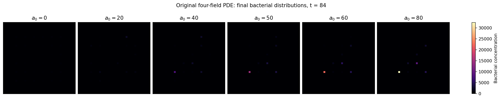
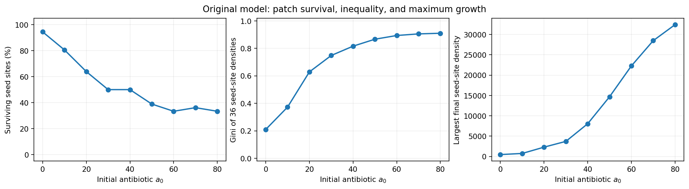
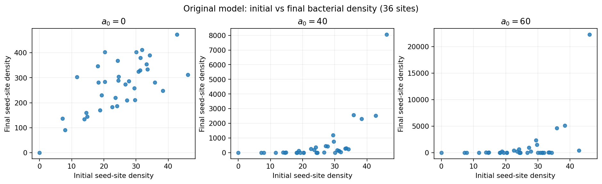
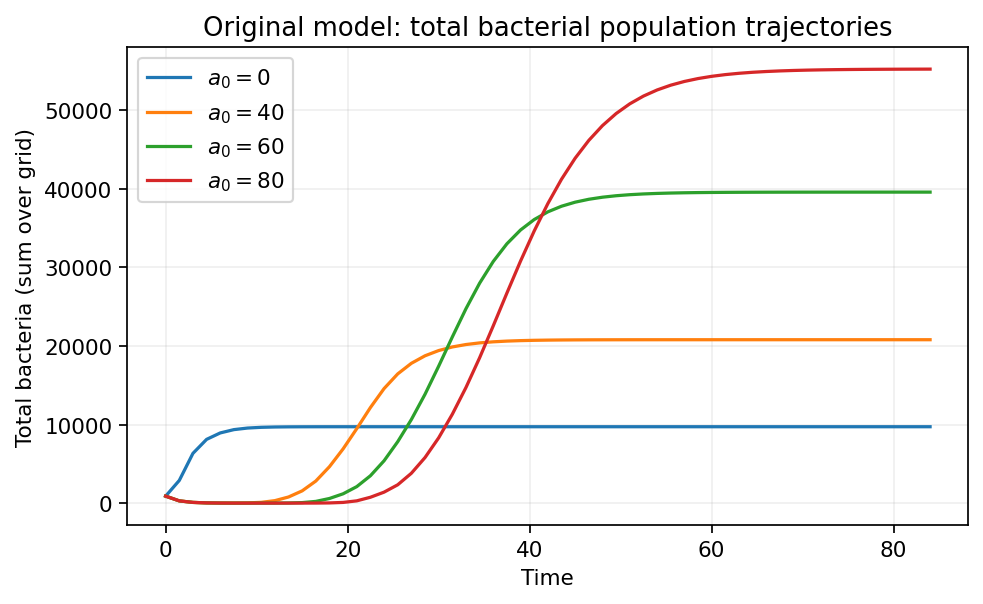
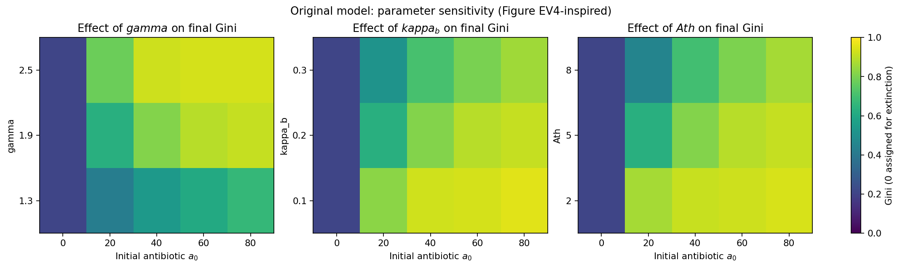
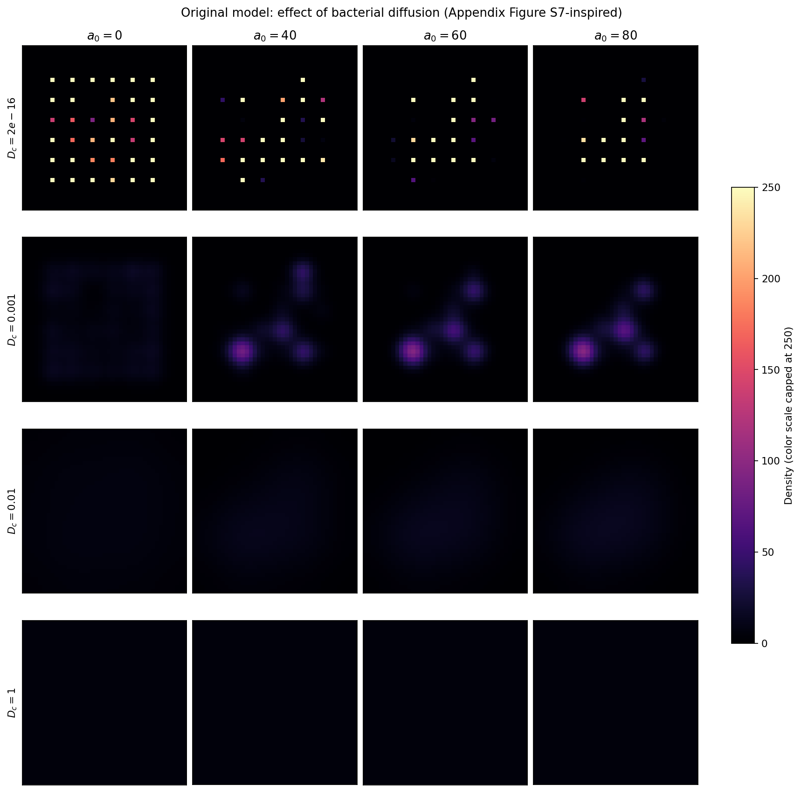
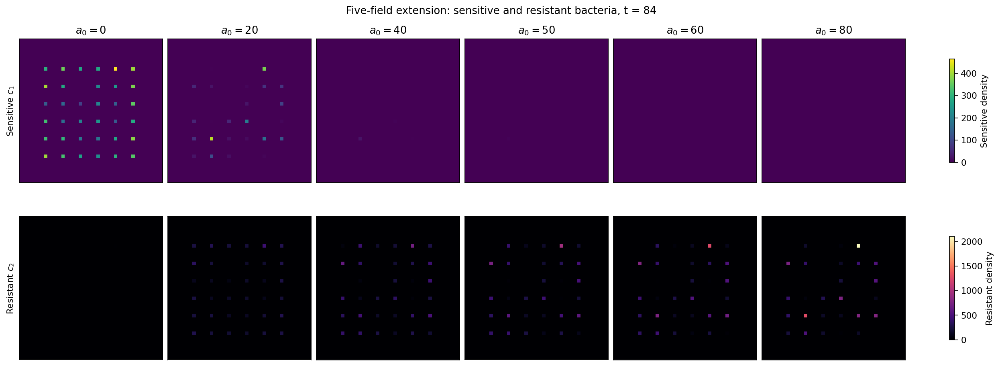
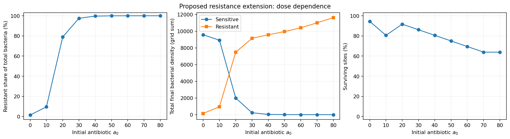
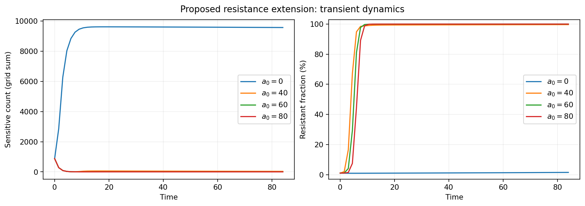
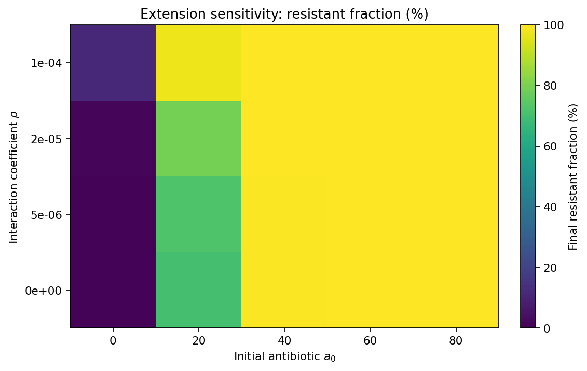

# Math 431: Project Proposal (Final): Disease Mutation in a Plane

- make g functions same, make gamma parameters same, change a thresholds in lysis

**Team Members:** Milo Glennon, Ben Guevel, Nathan Hoehndorf, Jack Morris

## Their Model

In the paper "A ‘rich-get-richer’ mechanism drives patchy dynamics and resistance evolution in antibiotic-treated bacteria" by Emrah Simsek et al. their model models the behavior of a diseased cell in a system with a fixed number of antibodies initially that are trying to kill them. In response, these cells will release enzymes that destroy the antibodies. In doing so the cells will use the nutrients that are initially distributed uniformly across the system these cells are in the system that they are in. In this example they use a discretized 2d space (which makes it look like a grid of pixels). 

$$
\begin{aligned}
    \begin{cases}
        \displaystyle\frac{\partial c}{\partial t} = (g-l)c+D_c\nabla^2c\\
        \displaystyle\frac{\partial n}{\partial t} = (\xi l-g)c+\nabla^2n\\
        \displaystyle\frac{\partial a}{\partial t} = -\kappa_Bba+D_a\nabla^2a\\
        \displaystyle\frac{\partial b}{\partial t} = lc-d_bb+D_c\nabla^2c
    \end{cases}
\end{aligned}
$$

 Where the functions $g$ and $l$ are the reproduction and lysis rate of the cells. When a cell undergoes lysis they break down their outer membrane and scatter all of the enzymes that they produced to thwart the effect of the antibodies. Their functions are listed below:

$$
\begin{aligned}
    g&=\frac{n}{1+n}\left(1-\frac{c}{c_{max}}\right)\\
    l&=\begin{cases}
        \gamma g, & \mathrm{if } a \ge A_{th}\\
        0, & \mathrm{otherwise}
    \end{cases}
\end{aligned}
$$

 With variables, parameters, and initial conditions all explained below:

### Variables

| Symbol | Description |
| --- | --- |
| $c$ | Cell population |
| $n$ | Nutrient concentration |
| $a$ | Antibody population |
| $b$ | Enzyme population |

### Parameter Estimates

| Symbol | Description | Estimate |
| --- | --- | --- |
| $\gamma$ | Maximum lysis rate | 1.9 |
| $c_m$ | Local carrying capacity | $1\times10^6$ |
| $\kappa_b$ | Rate constant of enzyme-mediate antibiotic degradation | 0.2 |
| $d_b$ | Rate constant for the spontaneous decay of antibiotic inactivating enzyme | 0.012 |
| $\xi$ | Coefficient of nutrient turnover from lysed cells | 0.8 |
| $A_{th}$ | Antibiotic concentration killing threshold | 5 |
| $D_c$ | Cell dispersal | $2\times10^{-16}$ |
| $D_a$ | antibody dispersal | $8\times10^{-2}$ |
| $D_b$ | enzyme dispersal | $1\times10^{-4}$ |
| $D_n$ | nutrient dispersal | $1$ |

### Initial Conditions

| Symbol | Description | Estimate |
| --- | --- | --- |
| $c(t=0)$ | Starting cell population | Randomly Sampled |
| $n(t=0)$ | Starting nutrients | 5 |
| $b(t=0)$ | Starting enzyme count | 0 |
| $a(t=0)$ | Starting antibody count | $a_0$ |

Then using this we recreated their results using their proposed model so that we could compare to it later on.

## Original Model: Simulation Results

### Spatial Distribution Across Antibiotic Doses

Final bacterial distributions at $t=84$ for different initial antibiotic concentrations $a_0$.

### Survival, Inequality, and Maximum Density

Percentage of surviving seed sites, Gini coefficient of seed-site densities, and largest final seed-site density as functions of initial antibiotic concentration $a_0$.

### Initial Versus Final Bacterial Density

Initial and final bacterial densities at 36 seed sites for initial antibiotic concentrations $a_0=0$, $40$, and $60$.

### Bacterial Population Over Time

Total bacterial density, summed over the grid, over time for initial antibiotic concentrations $a_0=0$, $40$, $60$, and $80$.

### Parameter Sensitivity

Final Gini coefficient as the lysis parameter $\gamma$, antibiotic degradation parameter $\kappa_b$, and antibiotic killing threshold $A_{th}$ vary with initial antibiotic concentration $a_0$.

### Effect of Bacterial Diffusion

Bacterial density for four bacterial diffusion coefficients $D_c$ and four initial antibiotic concentrations $a_0$. The displayed color scale is capped at 250

## Our Model

Our goal for this project was to expand on the cell population and add a new cell population that has a resistance towards the antibodies. This will answer the research question of our project "How will cell mutations that resist antibodies affect the population dynamics of the system?" One thing we should clarify is that this mutation forms a resistance and not an immunity so the cells can still die out over time. So we broke down $c$ into $c_1$, $c_2$ into the two populations as listed previously with an interaction term that allows for one cell to mutate into the new resistant cell at any given time with a constant proportion. This then affects the nutrient and enzyme levels according to this new model: 

$$
\begin{aligned}
    \begin{cases}
        \displaystyle\frac{\partial c_1}{\partial t} = (g_1-l_1)c_1-pc_1c_2+D_{c_1}\nabla^2c\\
        \displaystyle\frac{\partial c_2}{\partial t} = pc_1c_2+(g_2-l_2)c_2+D_{c_2}\nabla^2c\\
        \displaystyle\frac{\partial n}{\partial t} = (\xi_1 l_1-g_1)c_1+(\xi_2l_2-g_2)c_2+\nabla^2n\\
        \displaystyle\frac{\partial a}{\partial t} = -\kappa_Bba+D_a\nabla^2a\\
        \displaystyle\frac{\partial b}{\partial t} = l_1c_1+l_2c_2-d_bb+D_c\nabla^2c
    \end{cases}
\end{aligned}
$$

 Where the functions $g_1,g_2,l_1,l_2$ are listed below and have the same function as the original model but $g_1$ and $l_1$ are for the $c_1$ population and likewise for the $c_2$ population

$$
\begin{aligned}
    g_1 &=\frac{n}{1+n}\left(1-\frac{c_1}{c_{max}-c_2}\right) & l_1&=\begin{cases}
        \gamma_1 g_1 &\text{if }a\ge A_{th}\\
        0 & \text{otherwise}
    \end{cases}\\
    g_2 &=\frac{n}{1+n}\left(1-\frac{c_2}{c_{max}-c_1}\right)&
    l_2 &=\begin{cases}
        \gamma_2 g_2 &\text{if }a\ge A_{th}\\
        0 & \text{otherwise}
    \end{cases}\\
\end{aligned}
$$

 We then used the same parameters as before:

### Variables

| Symbol | Description |
| --- | --- |
| $c_1$ | Nonresistant cell population |
| $c_2$ | Resistant cell population |
| $n$ | Nutrient concentration |
| $a$ | Antibody population |
| $b$ | Enzyme population |

### Parameter Estimates

| Symbol | Description | Estimate |
| --- | --- | --- |
| $\gamma_1$ | Maximum lysis rate for nonresistant cells | 1.9 |
| $\gamma_2$ | Maximum lysis rate for resistant cells | $1.9^*$ |
| $c_m$ | Local carrying capacity | $1\times10^6$ |
| $\kappa_b$ | Rate constant of enzyme-mediate antibiotic degradation | 0.2 |
| $d_b$ | Rate constant for the spontaneous decay of antibiotic inactivating enzyme | 0.012 |
| $\xi_1$ | Coefficient of nutrient turnover from lysed nonresistant cells | 0.8 |
| $\xi_2$ | Coefficient of nutrient turnover from lysed resistant cells | $0.8^*$ |
| $p$ | Proportion of nonresistant cells that mutate to resistant | $0.5^*$ |
| $A_{th}$ | Antibiotic concentration killing threshold | 5 |
| $D_c$ | Cell dispersal | $2\times10^{-16}$ |
| $D_a$ | antibody dispersal | $8\times10^{-2}$ |
| $D_b$ | enzyme dispersal | $1\times10^{-4}$ |
| $D_n$ | nutrient dispersal | $1$ |

### Initial Conditions

| Symbol | Description | Estimate |
| --- | --- | --- |
| $c(t=0)$ | Starting cell population | Randomly Sampled |
| $n(t=0)$ | Starting nutrients | 5 |
| $b(t=0)$ | Starting enzyme count | 0 |
| $a(t=0)$ | Starting antibody count | $a_0$ |

$*=$ parameters we made up for proposed idea.

## Our Results

After running a simulation with our model

### Sensitive and Resistant Bacterial Distributions

Spatial distributions of sensitive bacteria $c_1$ (top) and resistant bacteria $c_2$ (bottom) at $t=84$ for different initial antibiotic concentrations $a_0$. Each row uses its own color scale.

### Resistance as a Function of Antibiotic Dose

Final resistant share of the bacterial population, total final sensitive and resistant bacterial densities summed over the grid, and percentage of surviving sites as functions of initial antibiotic concentration $a_0$.

### Sensitive Population and Resistant Fraction Over Time

Sensitive bacterial density summed over the grid (left) and resistant fraction of the total bacterial population (right) over time for initial antibiotic concentrations $a_0=0$, $40$, $60$, and $80$.

### Sensitivity to the Interaction Coefficient

Final resistant fraction as a function of initial antibiotic concentration $a_0$ and interaction coefficient $\rho$, using the notation shown in the supplied plot.

We recognize that $c_2$ growing almost without bound is something that need to be addressed else the formulation of the problem will always have the same result that being $c_2$ exploding in value. We are looking for ways that we can either toss a logistic term or other interactions to at least dampen the rise of the $c_2$ population concentration in the model. We will also have to investigate adding additional dynamics that relate the the lysis rate and the growth rate g for the $c_2$ bacteria population, this may end up adding one more PDE term that has some sort of growth reduction effect on the $c_2$ population. This would bring it more into line with a physical bacteria system that could actually exist in the real world. We would also enjoy having bacteria resistance being a spectrum of resistance between 0-100 but we haven’t figured out how to integrate something like that quite yet, as this would also help solve the resistant population exploding as some would still be more susceptible than others and depending on the population in the discrete quintile population.

## Model Investigation and Analysis

We intend to look at a variety of different methods to investigate what leads to an outbreak of resistant and/or susceptible bacteria:  

- Extension of Model:

  - We are also considering extending our model/scenario to include an antibiotic component to examine the growth of a resistant bacteria in a setting where it is being treated. We likely will see that resistant bacteria thrives under exposure to increased production of antibodies.

- Bifurcation analysis:

  - Find bifurcation points to see if changing concentration of antibodies, resistant cell concentration, and sensitive cell concentration lead to more interesting dynamics.

- Equilibrium and stability analysis:

  - This will check which cells will eventually dominate the other or if there is an equilibrium that will form.

- Sensitivity analysis:

  - How the dynamics of the syste will change depending on small changes in the parameters. We could also find ways for the cells to live longer or shorter in this system depending on what we want the model to do.
